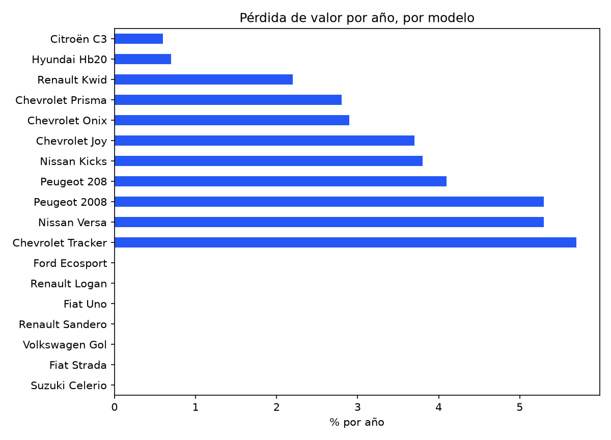
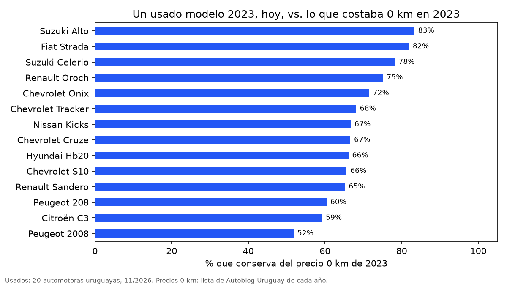

# Vidriera Insights — 23/11/2026

Análisis de **1,751 autos usados activos** (USD) de **20 automotoras** uruguayas,
a partir de los datos públicos de [Vidriera](https://vidriera-uy.vercel.app).

## 1. Marcas con más stock

| brand         |   listings |   median_price |   median_year |   median_km |
|:--------------|-----------:|---------------:|--------------:|------------:|
| Chevrolet     |        440 |          13495 |          2020 |       74670 |
| Renault       |        162 |          10545 |          2019 |       94915 |
| Nissan        |        130 |          14490 |          2018 |       92784 |
| Volkswagen    |        126 |          12990 |          2018 |       95169 |
| Fiat          |        113 |           9990 |          2018 |      106584 |
| Hyundai       |        106 |          14890 |          2021 |       95000 |
| Peugeot       |        101 |          11800 |          2017 |       98000 |
| Suzuki        |         71 |          10490 |          2019 |       84840 |
| Citroën       |         69 |          11900 |          2020 |       83570 |
| Ford          |         63 |          11590 |          2017 |      114000 |
| Gwm           |         32 |          13240 |          2019 |       92053 |
| Mercedes-Benz |         30 |          23950 |          2013 |      133000 |

## 2. Depreciación

### Curva general
Mediana del precio publicado según la antigüedad, como % de la mediana de los autos de **0–1 año que hoy
están en el stock usado** (no del precio de lista 0 km). Mezcla modelos distintos: los autos nuevos del
stock son más SUVs y marcas chinas que los viejos, así que la curva **exagera** la caída. Para comparar
autos de verdad, ver las tablas por modelo.

|   age |   listings |   median_price |   value_kept_pct |
|------:|-----------:|---------------:|-----------------:|
|     0 |         24 |          21950 |            107.2 |
|     1 |         75 |          18990 |             92.8 |
|     2 |        131 |          17500 |             85.5 |
|     3 |        151 |          16500 |             80.6 |
|     4 |        144 |          15345 |             75   |
|     5 |        101 |          16390 |             80.1 |
|     6 |        120 |          13945 |             68.1 |
|     7 |        114 |          12490 |             61   |
|     8 |        175 |          11900 |             58.1 |
|     9 |         96 |          11240 |             54.9 |
|    10 |         72 |          10945 |             53.5 |
|    11 |         82 |           9900 |             48.4 |
|    12 |         82 |          10140 |             49.5 |
|    13 |         74 |           9990 |             48.8 |
|    14 |         66 |           9600 |             46.9 |
|    15 |         56 |           8900 |             43.5 |

### Por modelo, separando edad y kilometraje
Dos regresiones log-lineales por modelo (autos de hasta 12 años, modelos con ≥20 publicaciones):

- `total_yearly_loss_pct`: `log(precio) ~ antigüedad`. La pérdida anual que ve un comprador, que mezcla
  envejecer y sumar kilómetros.
- `yearly_loss_pct`: `log(precio) ~ antigüedad + km`. La pérdida **solo por edad**, a igual kilometraje.
- `loss_per_10k_km_pct`: en la misma regresión, la pérdida por cada **10.000 km** extra a igual edad.

Un valor bajo significa que el modelo **retiene mejor su valor**. Muestras chicas dan coeficientes ruidosos
(un valor negativo en km indica justamente eso).

| brand      | model    |   listings |   median_price |   yearly_loss_pct |   loss_per_10k_km_pct |   total_yearly_loss_pct |
|:-----------|:---------|-----------:|---------------:|------------------:|----------------------:|------------------------:|
| Citroën    | C3       |         32 |          12850 |               0.6 |                   3.4 |                     3.3 |
| Hyundai    | Hb20     |         34 |          13990 |               0.7 |                   3.1 |                     3.6 |
| Renault    | Kwid     |         28 |           9990 |               2.2 |                  -0.1 |                     2   |
| Chevrolet  | Prisma   |         29 |          10900 |               2.8 |                   1.1 |                     3.8 |
| Chevrolet  | Onix     |        147 |          13990 |               2.9 |                   2.1 |                     4.5 |
| Chevrolet  | Joy      |         53 |          11990 |               3.7 |                   1.4 |                     4.7 |
| Nissan     | Kicks    |         24 |          18445 |               3.8 |                   3.4 |                     5.7 |
| Peugeot    | 208      |         32 |          12900 |               4.1 |                   1.5 |                     4.7 |
| Peugeot    | 2008     |         23 |          13890 |               5.3 |                   0.3 |                     5.5 |
| Nissan     | Versa    |         28 |          13700 |               5.3 |                   0.9 |                     5.7 |
| Chevrolet  | Tracker  |         43 |          17900 |               5.7 |                   1.3 |                     6.8 |
| Ford       | Ecosport |         21 |          12900 |             nan   |                 nan   |                     2.5 |
| Renault    | Logan    |         20 |           9745 |             nan   |                 nan   |                     2.6 |
| Fiat       | Uno      |         21 |           8990 |             nan   |                 nan   |                     3   |
| Renault    | Sandero  |         21 |           9890 |             nan   |                 nan   |                     3   |
| Volkswagen | Gol      |         20 |          12990 |             nan   |                 nan   |                     3.8 |
| Fiat       | Strada   |         21 |          15990 |             nan   |                 nan   |                     4.2 |
| Suzuki     | Celerio  |         20 |          10490 |             nan   |                 nan   |                     5.2 |

### Desde 0 km
Valor que conserva un usado frente a **lo que costaba 0 km el mismo modelo en su año**. Un Onix 2021 se
compara con el precio del Onix 0 km en 2021, no con el de hoy: los precios nuevos cambian bastante con los años y
usar el de hoy distorsiona la depreciación.

Los precios 0 km de cada año salen de la
[lista de Autoblog Uruguay](https://www.autoblog.com.uy/p/precios-0km.html) tal como la guardó el
[Internet Archive](https://web.archive.org/) a comienzos de cada año (2019–2026, 5,926
precios). Por ejemplo, la mediana de las versiones comparables del Onix:

|   year |   new_price |   base_price |   versions |
|-------:|------------:|-------------:|-----------:|
|   2019 |       17290 |        14490 |          5 |
|   2020 |       18440 |        16290 |          4 |
|   2021 |       19990 |        16490 |          9 |
|   2022 |       20490 |        16990 |          9 |
|   2023 |       21690 |        17990 |          9 |
|   2024 |       22390 |        17190 |          9 |
|   2025 |       22690 |        17490 |          9 |
|   2026 |       23490 |        18990 |          7 |

Solo cuentan versiones **comparables** (misma motorización que los usados y sin sub-modelos que casi no aparecen
entre ellos, como el Swift Sport). Se ajusta `log(precio usado / precio 0 km de su año) ~ antigüedad` por modelo y
se lee a 1, 3 y 5 años, **solo dentro de las edades que cubren los datos** (un hueco aparece vacío). Como no se sabe
la versión de cada usado, `kept_3y_pct` compara contra la versión mediana y `kept_3y_vs_base_pct` contra la más
barata: el valor real está entre las dos.

Una curva **plana** (igual % a 1, 3 y 5 años) no es un error: significa que los usados de ese modelo acompañaron
la suba de su precio 0 km, así que uno de 2019 vale, respecto de lo que costó, lo mismo que uno de 2024.

Límites: son precios de lista (sin las bonificaciones de las concesionarias, lo que exagera un poco la pérdida) y
precios publicados de usados (no de venta).

| brand     | model   |   used_listings | years_covered   |   median_used_age |   kept_1y_pct |   kept_3y_pct |   kept_5y_pct |   kept_3y_vs_base_pct |
|:----------|:--------|----------------:|:----------------|------------------:|--------------:|--------------:|--------------:|----------------------:|
| Suzuki    | Alto    |              13 | 2019–2023       |                 5 |         nan   |          83.3 |          82.8 |                  94   |
| Fiat      | Strada  |              16 | 2020–2026       |                 2 |          85.3 |          81.9 |          78.7 |                  98.3 |
| Suzuki    | Celerio |              13 | 2019–2024       |                 6 |          76.3 |          78.2 |          80   |                  84.7 |
| Renault   | Oroch   |              13 | 2019–2026       |                 5 |          84.8 |          75.1 |          66.6 |                  83.4 |
| Chevrolet | Onix    |             126 | 2019–2025       |                 4 |          69.4 |          71.5 |          73.7 |                  86.2 |
| Chevrolet | Tracker |              30 | 2019–2026       |                 4 |          71.5 |          68.1 |          64.8 |                  74.9 |
| Nissan    | Kicks   |              23 | 2019–2025       |                 3 |          74.9 |          66.7 |          59.4 |                  71.9 |
| Chevrolet | Cruze   |              11 | 2019–2023       |                 3 |         nan   |          66.6 |          60   |                  66.6 |
| Hyundai   | Hb20    |              33 | 2019–2026       |                 3 |          67.7 |          66.1 |          64.5 |                  92.6 |
| Chevrolet | S10     |              11 | 2021–2026       |                 1 |          67.3 |          65.6 |          64   |                  80   |
| Renault   | Sandero |              12 | 2019–2023       |                 5 |         nan   |          65.2 |          65.5 |                  67.7 |
| Peugeot   | 208     |              21 | 2019–2025       |                 3 |          69.6 |          60.4 |          52.4 |                  72.5 |
| Citroën   | C3      |              24 | 2020–2026       |                 2 |          76.2 |          59.2 |          46   |                  67.3 |
| Peugeot   | 2008    |              13 | 2019–2024       |                 4 |          60.3 |          51.8 |          44.5 |                  70.9 |

## 3. Kilometraje
A igual marca, modelo y año, cada **10.000 km extra** cambian el precio en **USD -162**.

## 4. Combustible y caja
El combustible se completa desde el título cuando el aviso no lo indica (por ejemplo "EV", "Híbrido",
"Seagull"), porque cerca de un cuarto de los avisos no lo cargan.

| fuel    |   listings |   median_price |   median_age |
|:--------|-----------:|---------------:|-------------:|
| Híbrido |         24 |          39395 |          2.5 |
| Diésel  |         67 |          28890 |          7   |
| Nafta   |        926 |          12900 |          7   |

| transmission   |   listings |   median_price |   median_age |
|:---------------|-----------:|---------------:|-------------:|
| Automática     |        226 |          18250 |            6 |
| Manual         |        375 |          10900 |            8 |

### Eléctricos e híbridos
| fuel      |   listings |   share_pct |   median_price |   median_year | top_brands                                          |
|:----------|-----------:|------------:|---------------:|--------------:|:----------------------------------------------------|
| Eléctrico |          7 |        0.4  |          24890 |        2024   | Byd (3), Volvo (1), Dongfeng (1), Volkswagen (1)    |
| Híbrido   |         24 |        1.37 |          39395 |        2023.5 | Hyundai (7), Bmw (3), Mercedes-Benz (3), Suzuki (2) |

Los eléctricos usados son casi todos de **2024–2026**: el mercado de eléctricos de segunda mano en Uruguay
recién empieza. Con tan pocos autos no tiene sentido estimar su depreciación todavía; la sección 8 sigue
cómo crece su participación semana a semana.

| brand      | model   |   year |   mileage_km |   price | source_name    |
|:-----------|:--------|-------:|-------------:|--------:|:---------------|
| Byd        | Seagull |   2024 |        95000 |   17690 | Amaya Motors   |
| Byd        | E2      |   2025 |        16000 |   21490 | Amaya Motors   |
| Byd        | E2      |   2024 |        27440 |   22990 | Motorlider     |
| Dongfeng   | Mage    |   2026 |          nan |   24890 | Usados Fidocar |
| Lynk & Co  | Lynk    |   2026 |        11882 |   33900 | Grupo Fiancar  |
| Volkswagen | Id. 4   |   2024 |         2800 |   44900 | Renato Conti   |
| Volvo      | C40     |   2022 |        35500 |   52990 | Amaya Motors   |

## 5. Modelo de precio (machine learning)
Gradient boosting (`HistGradientBoostingRegressor`) sobre marca, modelo, combustible, caja, carrocería,
antigüedad y kilometraje, con objetivo `log(precio)`. Validación cruzada de 5 particiones:

| Métrica | Valor |
|---|---|
| Error medio (todos los autos) | **17.8%** (USD 3,063) |
| Error en autos con comparables — modelo | **12.0%** |
| Error en autos con comparables — precio justo de Vidriera | 10.3% |
| Autos que el método de comparables puede tasar | 50% |
| Error del modelo en autos **sin** comparables | 24.6% |

El modelo **iguala** al método de comparables donde éste funciona y además **tasa el 100% del stock**,
incluidos los modelos raros que no tienen suficientes autos parecidos.

**Qué pesa más en el precio** (caída del R² al desordenar cada variable):

|              |   importancia_pct |
|:-------------|------------------:|
| age          |              45.2 |
| brand        |              27.7 |
| model        |              10.7 |
| fuel         |               6.8 |
| mileage_km   |               6   |
| transmission |               3   |
| body_type    |               0.7 |

**Candidatos a revisar**: autos del set de test publicados más por debajo de lo que espera el modelo
(una señal para mirar de cerca, no una garantía: el aviso puede tener detalles que los datos no capturan).

| brand      | model    |   year |   mileage_km |   price |   predicted |   discount_pct |
|:-----------|:---------|-------:|-------------:|--------:|------------:|---------------:|
| Ford       | Ka       |   2010 |       165741 |    6490 |       12226 |           46.9 |
| Ford       | Ka       |   2021 |        67244 |   13490 |       23277 |           42   |
| Jetour     | X70      |   2024 |        31000 |   19990 |       33699 |           40.7 |
| Honda      | Fit      |   2004 |       175900 |    7200 |       10909 |           34   |
| Chevrolet  | Spark    |   2014 |       153629 |    6990 |       10532 |           33.6 |
| Volkswagen | Suran    |   2014 |       208555 |    8990 |       13482 |           33.3 |
| Ford       | Ecosport |   2017 |       155007 |   10490 |       15389 |           31.8 |
| Chevrolet  | Sail     |   2014 |       192523 |    6990 |        9983 |           30   |
| Fiat       | Siena    |   2014 |       150000 |    5990 |        8259 |           27.5 |
| Chevrolet  | Montana  |   2025 |        37930 |   16990 |       22491 |           24.5 |

## 6. Cómo pone precio cada automotora
Negativo = más barata que autos comparables.

| source_name                |   listings |   median_vs_fair_pct |   share_above_fair |
|:---------------------------|-----------:|---------------------:|-------------------:|
| Califano                   |         12 |               -10.8  |                0   |
| Motorlider                 |         34 |                -9.95 |                5.9 |
| Gonzalo Ruiz Automóviles   |         17 |                -9.4  |               17.6 |
| Shopping de Autos          |         88 |                -7.45 |               10.2 |
| Mariño Sport               |         26 |                -5.9  |               15.4 |
| Grupo Fiancar              |         59 |                -4.7  |               15.3 |
| Carper Usados              |        256 |                 0    |               32   |
| Autoventas                 |         11 |                 0    |               18.2 |
| Car One                    |         82 |                 0    |               30.5 |
| Usados Fidocar             |         55 |                 0    |               32.7 |
| Amaya Motors               |         22 |                 3.1  |               50   |
| Drivers                    |         11 |                 4.8  |               45.5 |
| Julio Automóviles          |         55 |                 8.5  |               54.5 |
| Nicolás Tejera Automóviles |        110 |                11.25 |               66.4 |

## 7. ¿Los autos caros tardan más en venderse?
| bucket    |   listings |   median_days |   share_with_price_cut |
|:----------|-----------:|--------------:|-----------------------:|
| <-10%     |        175 |            45 |                   29.7 |
| -10 a -2% |        210 |            47 |                   25.2 |
| ±2%       |        141 |            47 |                   27.7 |
| +2 a +10% |        171 |            47 |                   18.1 |
| >+10%     |        184 |            47 |                    6   |

> Vidriera registra datos desde el 07/10/2026: esta tabla gana sentido
> a medida que se acumulan semanas de historia (días publicados y rebajas de precio).

## 8. Evolución del mercado
Stock, precio mediano y % de eléctricos e híbridos en cada foto semanal.

| snapshot_date       |   listings |   median_price |   electric_pct |   hybrid_pct |
|:--------------------|-----------:|---------------:|---------------:|-------------:|
| 2026-10-09 00:00:00 |       2605 |          12990 |              1 |            1 |
| 2026-10-19 00:00:00 |       2514 |          12990 |              1 |            2 |
| 2026-11-23 00:00:00 |       1751 |          12900 |              0 |            1 |
