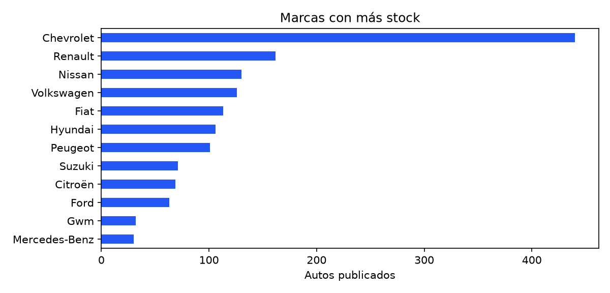
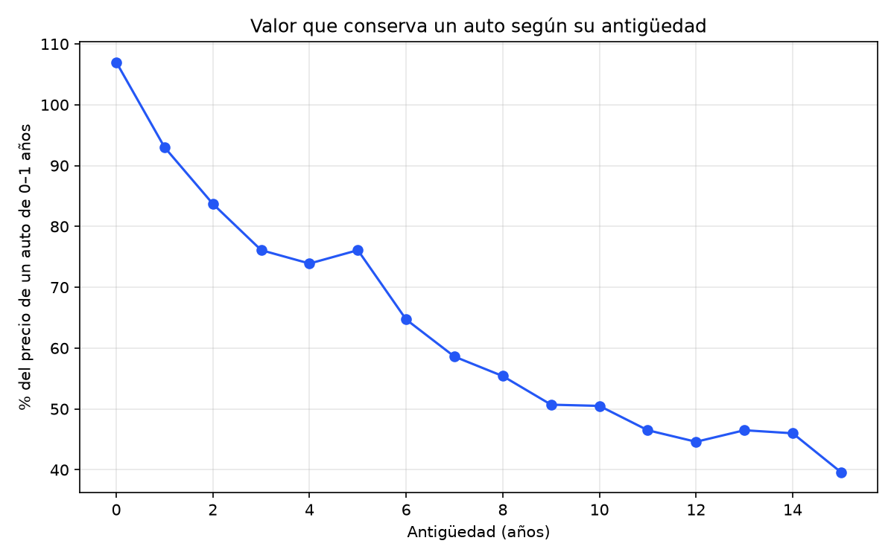
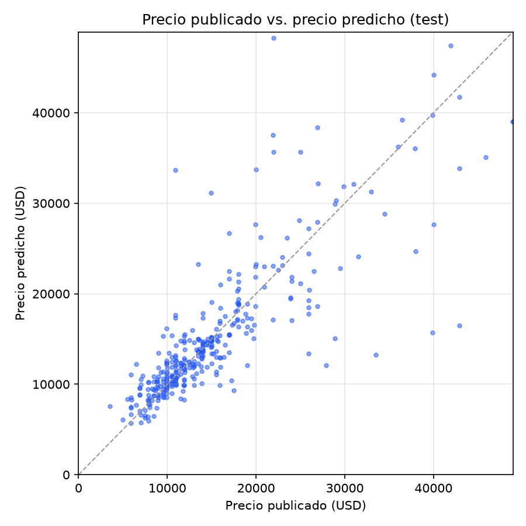
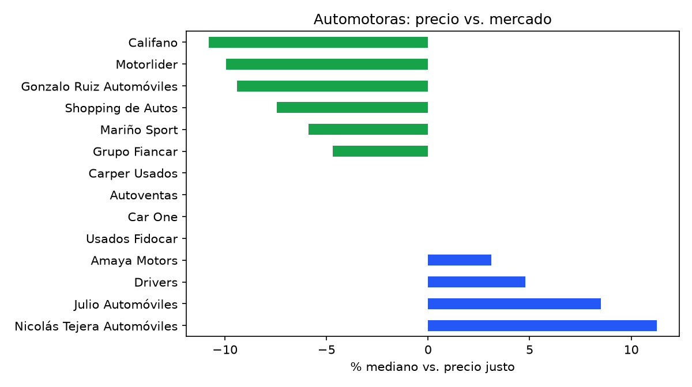

# Vidriera Insights — 19/10/2026

Análisis de **2,514 autos usados activos** (USD) de **33 automotoras** uruguayas,
a partir de los datos públicos de [Vidriera](https://vidriera-uy.vercel.app).

## 1. Marcas con más stock

| brand      |   listings |   median_price |   median_year |   median_km |
|:-----------|-----------:|---------------:|--------------:|------------:|
| Chevrolet  |        634 |          13090 |          2020 |       86454 |
| Renault    |        247 |          10990 |          2019 |       95304 |
| Fiat       |        186 |          10495 |          2018 |      107000 |
| Volkswagen |        173 |          13990 |          2018 |      105000 |
| Nissan     |        170 |          14945 |          2019 |       89635 |
| Peugeot    |        151 |          11800 |          2017 |       98000 |
| Hyundai    |        147 |          14500 |          2021 |       90058 |
| Suzuki     |        113 |          10900 |          2019 |       92451 |
| Ford       |         88 |          12490 |          2017 |      108000 |
| Citroën    |         86 |          11900 |          2019 |      101713 |
| Toyota     |         52 |          20700 |          2019 |      161500 |
| Chery      |         40 |          12640 |          2020 |       57701 |

## 2. Depreciación

### Curva general
Mediana del precio publicado según la antigüedad, como % de la mediana de los autos de **0–1 año que hoy
están en el stock usado** (no del precio de lista 0 km). Mezcla modelos distintos: los autos nuevos del
stock son más SUVs y marcas chinas que los viejos, así que la curva **exagera** la caída. Para comparar
autos de verdad, ver las tablas por modelo.

|   age |   listings |   median_price |   value_kept_pct |
|------:|-----------:|---------------:|-----------------:|
|     0 |         39 |          22990 |            107   |
|     1 |        101 |          19990 |             93   |
|     2 |        175 |          17990 |             83.7 |
|     3 |        200 |          16345 |             76.1 |
|     4 |        219 |          15890 |             73.9 |
|     5 |        158 |          16345 |             76.1 |
|     6 |        187 |          13900 |             64.7 |
|     7 |        174 |          12590 |             58.6 |
|     8 |        249 |          11900 |             55.4 |
|     9 |        153 |          10900 |             50.7 |
|    10 |        118 |          10850 |             50.5 |
|    11 |        124 |           9990 |             46.5 |
|    12 |        135 |           9590 |             44.6 |
|    13 |         97 |           9990 |             46.5 |
|    14 |         86 |           9895 |             46   |
|    15 |         73 |           8500 |             39.6 |

### Por modelo, separando edad y kilometraje
Dos regresiones log-lineales por modelo (autos de hasta 12 años, modelos con ≥20 publicaciones):

- `total_yearly_loss_pct`: `log(precio) ~ antigüedad`. La pérdida anual que ve un comprador, que mezcla
  envejecer y sumar kilómetros.
- `yearly_loss_pct`: `log(precio) ~ antigüedad + km`. La pérdida **solo por edad**, a igual kilometraje.
- `loss_per_10k_km_pct`: en la misma regresión, la pérdida por cada **10.000 km** extra a igual edad.

Un valor bajo significa que el modelo **retiene mejor su valor**. Muestras chicas dan coeficientes ruidosos
(un valor negativo en km indica justamente eso).

| brand      | model    |   listings |   median_price |   yearly_loss_pct |   loss_per_10k_km_pct |   total_yearly_loss_pct |
|:-----------|:---------|-----------:|---------------:|------------------:|----------------------:|------------------------:|
| Volkswagen | Saveiro  |         24 |          14990 |              -0.4 |                   2.4 |                     2.6 |
| Citroën    | C3       |         33 |          11900 |               1.5 |                   1.8 |                     2.7 |
| Hyundai    | Hb20     |         54 |          13990 |               2   |                   3.4 |                     4.5 |
| Renault    | Kwid     |         56 |           9990 |               2.1 |                   1.1 |                     3   |
| Renault    | Sandero  |         26 |           9900 |               2.3 |                   1.3 |                     3.1 |
| Chevrolet  | Joy      |         64 |          12190 |               2.4 |                   2.3 |                     4.1 |
| Volkswagen | Gol      |         29 |          11900 |               2.5 |                   0.9 |                     2.8 |
| Suzuki     | Celerio  |         38 |          11140 |               2.7 |                   1.5 |                     3.7 |
| Renault    | Duster   |         30 |          13140 |               3   |                   1   |                     3.6 |
| Chevrolet  | Prisma   |         39 |          10990 |               3.5 |                   1.2 |                     3.4 |
| Nissan     | Kicks    |         41 |          17990 |               3.5 |                   2.9 |                     6.1 |
| Chevrolet  | Onix     |        217 |          13990 |               3.6 |                   1.8 |                     5.2 |
| Fiat       | Strada   |         48 |          14500 |               4.2 |                   1.2 |                     5.6 |
| Peugeot    | 2008     |         26 |          14795 |               4.2 |                   2   |                     6.4 |
| Renault    | Oroch    |         39 |          14490 |               4.3 |                   1.6 |                     5.8 |
| Peugeot    | 208      |         59 |          13500 |               4.7 |                   1.1 |                     5.4 |
| Fiat       | Uno      |         34 |           8900 |               4.9 |                   0.3 |                     4.2 |
| Chevrolet  | Tracker  |         64 |          18640 |               5   |                   2.4 |                     7   |
| Ford       | Ecosport |         36 |          13240 |               6.7 |                  -0.6 |                     4.5 |
| Nissan     | Versa    |         29 |          16590 |               7   |                   0.6 |                     7   |
| Suzuki     | Alto     |         20 |           7990 |             nan   |                 nan   |                     3.2 |
| Renault    | Stepway  |         20 |          10895 |             nan   |                 nan   |                     4.7 |
| Fiat       | Mobi     |         20 |          10195 |             nan   |                 nan   |                     5.2 |

### Desde 0 km
Valor que conserva un usado frente a **lo que costaba 0 km el mismo modelo en su año**. Un Onix 2021 se
compara con el precio del Onix 0 km en 2021, no con el de hoy: los precios nuevos cambian bastante con los años y
usar el de hoy distorsiona la depreciación.

Los precios 0 km de cada año salen de la
[lista de Autoblog Uruguay](https://www.autoblog.com.uy/p/precios-0km.html) tal como la guardó el
[Internet Archive](https://web.archive.org/) a comienzos de cada año (2019–2026, 5,926
precios). Por ejemplo, la mediana de las versiones comparables del Onix:

|   year |   new_price |   base_price |   versions |
|-------:|------------:|-------------:|-----------:|
|   2019 |       17290 |        14490 |          5 |
|   2020 |       18440 |        16290 |          4 |
|   2021 |       19990 |        16490 |          9 |
|   2022 |       20490 |        16990 |          9 |
|   2023 |       21690 |        17990 |          9 |
|   2024 |       22390 |        17190 |          9 |
|   2025 |       22690 |        17490 |          9 |
|   2026 |       23490 |        18990 |          7 |

Solo cuentan versiones **comparables** (misma motorización que los usados y sin sub-modelos que casi no aparecen
entre ellos, como el Swift Sport). Se ajusta `log(precio usado / precio 0 km de su año) ~ antigüedad` por modelo y
se lee a 1, 3 y 5 años, **solo dentro de las edades que cubren los datos** (un hueco aparece vacío). Como no se sabe
la versión de cada usado, `kept_3y_pct` compara contra la versión mediana y `kept_3y_vs_base_pct` contra la más
barata: el valor real está entre las dos.

Una curva **plana** (igual % a 1, 3 y 5 años) no es un error: significa que los usados de ese modelo acompañaron
la suba de su precio 0 km, así que uno de 2019 vale, respecto de lo que costó, lo mismo que uno de 2024.

Límites: son precios de lista (sin las bonificaciones de las concesionarias, lo que exagera un poco la pérdida) y
precios publicados de usados (no de venta).

| brand      | model    |   used_listings | years_covered   |   median_used_age |   kept_1y_pct |   kept_3y_pct |   kept_5y_pct |   kept_3y_vs_base_pct |
|:-----------|:---------|----------------:|:----------------|------------------:|--------------:|--------------:|--------------:|----------------------:|
| Suzuki     | Swift    |              11 | 2020–2024       |               3   |          83.6 |          84.9 |          86.3 |                  88.5 |
| Fiat       | Strada   |              34 | 2019–2026       |               4   |          87.8 |          84.1 |          80.6 |                  97.2 |
| Chevrolet  | Joy      |              15 | 2020–2022       |               5   |         nan   |          83.6 |          79.7 |                  83.6 |
| Toyota     | Hilux    |              10 | 2019–2023       |               4.5 |         nan   |          82.4 |          79.8 |                 100   |
| Fiat       | Mobi     |              12 | 2019–2024       |               7   |          82.5 |          80.8 |          79.2 |                  84.2 |
| Chevrolet  | Montana  |              25 | 2024–2025       |               2   |          78.7 |          80   |         nan   |                  95.2 |
| Chevrolet  | Captiva  |              11 | 2020–2023       |               5   |         nan   |          75   |          59.7 |                  79.9 |
| Chevrolet  | Onix     |             171 | 2019–2025       |               4   |          71.3 |          72   |          72.8 |                  86.8 |
| Renault    | Kwid     |              48 | 2019–2026       |               4.5 |          72.1 |          71.5 |          71   |                  77.5 |
| Renault    | Oroch    |              30 | 2019–2026       |               4   |          78.2 |          71.5 |          65.4 |                  79.4 |
| Volkswagen | T-Cross  |              10 | 2020–2024       |               5   |          84   |          70.1 |          58.5 |                  87   |
| Volkswagen | Nivus    |              11 | 2021–2024       |               5   |          70.4 |          69.6 |          68.8 |                  73.5 |
| Hyundai    | Hb20     |              49 | 2019–2026       |               3   |          71   |          69.2 |          67.4 |                  96.9 |
| Chevrolet  | Tracker  |              47 | 2019–2026       |               5   |          71.7 |          68.3 |          65   |                  74.7 |
| Chevrolet  | Cruze    |              12 | 2019–2023       |               3.5 |         nan   |          67.8 |          60.4 |                  67.8 |
| Nissan     | Kicks    |              36 | 2019–2026       |               3   |          77   |          67.6 |          59.3 |                  72.8 |
| Chevrolet  | S10      |              13 | 2021–2026       |               1   |          66.2 |          63.1 |          60   |                  76.9 |
| Peugeot    | 208      |              37 | 2019–2025       |               3   |          72.8 |          63.1 |          54.8 |                  75.8 |
| Citroën    | C3       |              23 | 2019–2025       |               3   |          77.5 |          61.6 |          48.9 |                  70   |
| Citroën    | C4       |              13 | 2019–2025       |               6   |          69.1 |          60.9 |          53.7 |                  66   |
| Nissan     | Sentra   |              13 | 2020–2025       |               4   |          64.4 |          58.7 |          53.5 |                  64   |
| Peugeot    | 2008     |              16 | 2019–2025       |               4   |          57.7 |          55.6 |          53.6 |                  76.1 |
| Renault    | Duster   |              15 | 2019–2025       |               4   |          56.9 |          55.5 |          54.1 |                  64.1 |
| Ford       | Ecosport |              15 | 2019–2021       |               6   |         nan   |         nan   |          54.8 |                 nan   |

## 3. Kilometraje
A igual marca, modelo y año, cada **10.000 km extra** cambian el precio en **USD -180**.

## 4. Combustible y caja
El combustible se completa desde el título cuando el aviso no lo indica (por ejemplo "EV", "Híbrido",
"Seagull"), porque cerca de un cuarto de los avisos no lo cargan.

| fuel      |   listings |   median_price |   median_age |
|:----------|-----------:|---------------:|-------------:|
| Híbrido   |         38 |          32695 |            2 |
| Diésel    |         89 |          29890 |            6 |
| Eléctrico |         16 |          23440 |            1 |
| Nafta     |       1684 |          12900 |            7 |

| transmission   |   listings |   median_price |   median_age |
|:---------------|-----------:|---------------:|-------------:|
| Automática     |        448 |          18490 |            6 |
| Manual         |        852 |          10945 |            8 |

### Eléctricos e híbridos
| fuel      |   listings |   share_pct |   median_price |   median_year | top_brands                                               |
|:----------|-----------:|------------:|---------------:|--------------:|:---------------------------------------------------------|
| Eléctrico |         16 |        0.64 |          23440 |          2025 | Byd (4), Chevrolet (4), Bmw (2), Changan (1)             |
| Híbrido   |         38 |        1.51 |          32695 |          2024 | Hyundai (11), Toyota (10), Suzuki (3), Mercedes-Benz (2) |

Los eléctricos usados son casi todos de **2024–2026**: el mercado de eléctricos de segunda mano en Uruguay
recién empieza. Con tan pocos autos no tiene sentido estimar su depreciación todavía; la sección 8 sigue
cómo crece su participación semana a semana.

| brand     | model   |   year |   mileage_km |   price | source_name          |
|:----------|:--------|-------:|-------------:|--------:|:---------------------|
| Changan   | E-Star  |   2024 |            1 |   12490 | Car One              |
| Byd       | Seagull |   2024 |        95000 |   17990 | Amaya Motors         |
| Byd       | E2      |   2024 |       105000 |   18490 | Shopping Car         |
| Byd       | E2      |   2021 |        62400 |   18990 | Vipercar             |
| Jac       | E-S3    |   2026 |        15557 |   19900 | Shopping de Autos    |
| Chevrolet | Spark   |   2026 |        90000 |   19990 | Vladimir Automóviles |
| Chevrolet | Spark   |   2026 |        23000 |   20990 | Oliva Automotores    |
| Jmc       | Jmev    |   2025 |           21 |   21990 | Car One              |
| Dongfeng  | Mage    |   2026 |          nan |   24890 | Usados Fidocar       |
| Byd       | Yuan    |   2026 |        16000 |   27490 | Shopping Car         |
| Tesla     | Model   |   2022 |        65000 |   34990 | Vladimir Automóviles |
| Volvo     | C40     |   2022 |        35500 |   52990 | Amaya Motors         |
| Chevrolet | Equinox |   2025 |        10617 |   58590 | Silca                |
| Chevrolet | Blazer  |   2025 |         7301 |   65990 | Silca                |
| Bmw       | Ix2     |   2025 |        37000 |   78900 | Grupo Fiancar        |
| Bmw       | I4      |   2024 |         4941 |   89900 | Arbeleche            |

## 5. Modelo de precio (machine learning)
Gradient boosting (`HistGradientBoostingRegressor`) sobre marca, modelo, combustible, caja, carrocería,
antigüedad y kilometraje, con objetivo `log(precio)`. Validación cruzada de 5 particiones:

| Métrica | Valor |
|---|---|
| Error medio (todos los autos) | **15.0%** (USD 2,547) |
| Error en autos con comparables — modelo | **10.5%** |
| Error en autos con comparables — precio justo de Vidriera | 10.2% |
| Autos que el método de comparables puede tasar | 59% |
| Error del modelo en autos **sin** comparables | 20.7% |

El modelo **iguala** al método de comparables donde éste funciona y además **tasa el 100% del stock**,
incluidos los modelos raros que no tienen suficientes autos parecidos.

**Qué pesa más en el precio** (caída del R² al desordenar cada variable):

|              |   importancia_pct |
|:-------------|------------------:|
| age          |              44.7 |
| brand        |              23.7 |
| model        |              14.4 |
| fuel         |               6.4 |
| mileage_km   |               5   |
| transmission |               3.6 |
| body_type    |               2.1 |

**Candidatos a revisar**: autos del set de test publicados más por debajo de lo que espera el modelo
(una señal para mirar de cerca, no una garantía: el aviso puede tener detalles que los datos no capturan).

| brand      | model    |   year |   mileage_km |   price |   predicted |   discount_pct |
|:-----------|:---------|-------:|-------------:|--------:|------------:|---------------:|
| Citroën    | Berlingo |   2022 |       107000 |   14900 |       26152 |           43   |
| Volkswagen | Up       |   2020 |       105761 |   11490 |       20129 |           42.9 |
| Chevrolet  | Corsa    |   2010 |       199000 |    3900 |        6394 |           39   |
| Peugeot    | 2008     |   2019 |        49252 |   12900 |       20797 |           38   |
| Honda      | Wr-V     |   2022 |        31600 |   15490 |       23290 |           33.5 |
| Nissan     | Tiida    |   2013 |       135981 |    7900 |       11726 |           32.6 |
| Nissan     | Versa    |   2023 |        73158 |   11900 |       17230 |           30.9 |
| Volkswagen | Polo     |   2021 |        57721 |   14690 |       20973 |           30   |
| Renault    | Oroch    |   2020 |       167742 |    9990 |       14279 |           30   |
| Nissan     | Sentra   |   2010 |       240000 |    5990 |        8446 |           29.1 |

## 6. Cómo pone precio cada automotora
Negativo = más barata que autos comparables.

| source_name                |   listings |   median_vs_fair_pct |   share_above_fair |
|:---------------------------|-----------:|---------------------:|-------------------:|
| Automotora Barriola        |         26 |               -13.4  |                0   |
| Gonzalo Ruiz Automóviles   |         18 |                -9.75 |               16.7 |
| Kaitazoff                  |         16 |                -8.5  |               18.8 |
| Motorlider                 |         38 |                -7.65 |                5.3 |
| Silca                      |        111 |                -6.7  |               12.6 |
| Grupo Fiancar              |         79 |                -6.3  |               16.5 |
| Shopping de Autos          |         94 |                -5.8  |                9.6 |
| Shopping Car               |         16 |                -5.6  |               12.5 |
| Facilcar                   |         15 |                -5.1  |               26.7 |
| Moreira Automóviles        |         17 |                -5    |                5.9 |
| Arbeleche                  |         11 |                -3.4  |               36.4 |
| Kleist Automóviles         |         15 |                -3.1  |               26.7 |
| AG Automóviles             |         13 |                -2.4  |               15.4 |
| Mariño Sport               |         27 |                -0.3  |               22.2 |
| Vipercar                   |        120 |                -0.05 |               29.2 |
| Car One                    |        124 |                 0    |               36.3 |
| Vladimir Automóviles       |         21 |                 0    |               23.8 |
| Usados Fidocar             |         71 |                 0    |               33.8 |
| Carper Usados              |        300 |                 0    |               32.3 |
| Oliva Automotores          |         11 |                 0    |               27.3 |
| Autoventas                 |         10 |                 0.7  |               30   |
| LR Automóviles             |         12 |                 1.95 |               33.3 |
| Amaya Motors               |         26 |                 4.7  |               46.2 |
| Drivers                    |         14 |                 8.25 |               71.4 |
| Julio Automóviles          |         66 |                 9.6  |               56.1 |
| Nicolás Tejera Automóviles |        128 |                10.3  |               64.1 |
| Chevrolet Florida          |         39 |                13.4  |               79.5 |

## 7. ¿Los autos caros tardan más en venderse?
| bucket    |   listings |   median_days |   share_with_price_cut |
|:----------|-----------:|--------------:|-----------------------:|
| <-10%     |        275 |            12 |                    9.8 |
| -10 a -2% |        360 |            12 |                    6.1 |
| ±2%       |        257 |            12 |                    8.9 |
| +2 a +10% |        282 |            12 |                    4.6 |
| >+10%     |        303 |            12 |                    2.6 |

> Vidriera registra datos desde el 07/10/2026: esta tabla gana sentido
> a medida que se acumulan semanas de historia (días publicados y rebajas de precio).

## 8. Evolución del mercado
Stock, precio mediano y % de eléctricos e híbridos en cada foto semanal.

| snapshot_date       |   listings |   median_price |   electric_pct |   hybrid_pct |
|:--------------------|-----------:|---------------:|---------------:|-------------:|
| 2026-10-09 00:00:00 |       2605 |          12990 |              1 |            1 |
| 2026-10-19 00:00:00 |       2514 |          12990 |              1 |            2 |
